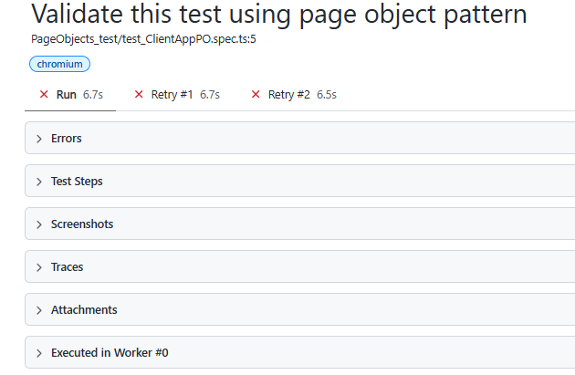

# Playwright_workspace

Basics and AI capability

#Install - npm init playwright@latest
#Running the Example Test - $npx playwright test
Report -
npx playwright show-report

Notes - all browsers will place here
-C:\Users\pc\AppData\Local\ms-playwright

#Run

- Run Simple .ts file - $ node .\test1.ts

- Run Through test Runner cmd , Test runner window will open
  $npx playwright test --ui

- Debug using CodeGen tool Given by playwright ,
  - You can inspect locator at Run time
  - No need extra plugin
  - $npx playwright test 02LocatorSmart.spec.ts --debug

- Record and playback using Codegen
  - npx playwright codegen https://rahulshettyacademy.com/angularpractice/

- Run only only one browser
  - npx playwright test 02LocatorSmart.spec.ts --debug --project=chromium

- IQ- How can you run test case on different config file
  - $npx playwright test 02LocatorSmart.spec.ts --config playwright.config_1.ts
  - Benefits examples-
  - Suppose you want to execute particular project with some setting
  - Project-1 on headless/firefox and project-2 on chrome
  - Run on QA /UAT-1/ UAT-2

- IQ - How to run test case on iphone 18 / Andriod /
  - do setting on config file
  - check browserName : webkit
    ...devices['iphone 18']

- Handle SSL certification?
  - ignoreHTTPSErrors:true
    -Set permission like location permissions:['geolocation'],

- IQ- How to record video for failed test/1st retry?
- video: 'on-first-retry/retain-on-failure',

- Check reort directly Refrash each time- http://localhost:9323/

- Add screenshot in config.ts file
  browserName: 'chromium',
  headless: false,
  screenshot: 'on',
  trace:'on' -for all pass/fail
  trace:'retain-on-failure' - to save memory and faster execution

- CSS selector
  - . for class ex- .test-clas
  - # for id ex- #dom-id

# How to debug the API steps in script using Visual code debugging

- Using --debug cmds mode -> only UI scripts can be debug
- Question - How to debug API scripts?
- Goto "package.json"
  "scripts": {
  "test": "npx playwright test tests/03RahulAPI/02Web_Api_utils.spec.ts --headed"
  },
- From search VS code - "Shift+ Ctrl +p" -> select -> debug: debug npm Script
- timeout: 180 \* 1000, //Keep 3 minutes use for API calls in config.ts file

#. Detailed view of Trace viewer to understand the "API" logging req/responses

- this is beautiful feature to check logs for API -Very good to trace logs
- Set in config.ts
  trace: 'on'
- Run API test case from terminal -$npx playwright test 02Web_Api_utils.spec.ts
- and check test-results folder -> trace.zip
- open this URL and upload -https://trace.playwright.dev/

Q) What are Playwright Fixtures - Understand their use cases & Steps to implement

- Build UI Login Fixture & API call Fixture for a Test - Example
- Demo of 3 Custom Fixtures -Data driven, UI & API with Setup & TearDown unit code

- Fixture is reuseable unit of code tosetup and tearDown that PW injects to test cases
- Build-in Fixture {browser, page, context}
- Custome fixture [Create for Login functionality]
  -"Heavy lifting " should be done already and focus on actual TC
- step-1 goto Utils folder -> import test
- step-2 extend original base test & export
- Step-3 import in acutal test
- Data Driven functionality we can acchieve Using this Fixture also. (See examples)

#. Read write Excel file and Json
There are 2 library

1.  npm install xlsx
    - Using xlsx — Recommended for data processing
    - Fast parsing; lightweight; converts sheet to JSON in one line.
    - Standard choice if you want to read an .xlsx file and convert its rows directly into strongly-typed JavaScript/TypeScript objects
    - Parse to Json then read in faster ways
    - Disadvantage- take more memory

2.  npm install exceljs

- Recommended if you need cell styles or manual iteration
- To write
- is ideal if you need to read Excel structures cell-by-cell or access formulas, rich text formatting, or row numbers directly.

#- Page Object Pattern

- Create a Page object folder
- Page Object Manager class -
  - Page Object Manager (POM) class acts as a "single registry or factory" that instantiates
    and manages all your Page Object instance

# How to read Json file?

- Create a TestData.json file in testData folder
- import that file and covert [Json -> string -> Js Object]
- So parsing issue will not come if any UTF encoding data is there in file
- example codes-
- const dataSet = JSON.parse(JSON.stringify(require("../testData/JsonTestData.json"))); //not working
- import dataSet from "../testData/JsonTestData.json"; //Working for me

# How to parametrize Json test data file?

- Check test_ClientAppPO.spec.ts file, this will run multiple time
  for (const data of dataSet)
  test(`Execute test for multiple set of data ${data.productName}`, async () => {

        console.log(data.email);
        console.log(data.password);
        console.log(data.productName);

  })

# How to pass test data as fixture by extend test annotation behaviour

- "Not much use ful"
- Create a .ts File
- create a custom test and extend it from {base} fixture
- export it - check this file -> test-base-Fixture.ts // test data will be here
- import it and call from test file -test_testBaseFixture.spec.ts

# AI with Playwright

- MCP git - all tools are avaliable
- write simple english and LLM will execute using tools
- https://github.com/microsoft/playwright-mcp
- Configuration -

# Playwright Test Execution: Retry, Parallel, Serial & Tagging

This document explains how to configure and execute Playwright test cases using different execution strategies, including **Retry, Parallel Execution, Serial Execution, and Test Tagging**.

## 1. Retry Mechanism

### What is Retry?

Retry is used to automatically re-execute failed test cases.

For example, if a test case fails due to a temporary issue such as network latency or application loading, Playwright can retry the test automatically.

### Configuration

1. Open the `playwright.config.ts` file.
2. Add the `retries` property inside the configuration.

```typescript
import { defineConfig } from "@playwright/test";

export default defineConfig({
  retries: 2,
});
```

**Explanation:**

- `retries: 0` – No retry.
- `retries: 1` – Retry once if the test fails.
- `retries: 2` – Retry twice if the test fails.

**Example:** If a test case fails during its first execution and `retries: 2` is configured, Playwright will execute it up to 3 times (1 initial execution + 2 retries).

### Execute Test Using Terminal

```bash
npx playwright test "tests/PageObjects_test/test_ClientAppPO.spec.ts" --headed
```

### Retry Execution Flow

```text
Test Case Execution
        |
        v
   Test Passed?
     /     \
   Yes      No
   |         |
  End    Retry 1
             |
         Test Passed?
          /      \
        Yes       No
        |          |
       End      Retry 2
                    |
                Final Result
```

### Retry Report

The Playwright HTML report displays the retry attempts for failed test cases.



---

## 2. Parallel Execution

### What is Parallel Execution?

Parallel execution allows Playwright to execute multiple test files simultaneously using multiple workers.

- By default, Playwright runs test files in parallel.
- Playwright uses up to 50% of available CPU cores as workers by default.
- You can manually configure the number of workers in the configuration file.

### Configure Workers

Open `playwright.config.ts` and configure:

```typescript
import { defineConfig } from "@playwright/test";

export default defineConfig({
  workers: 5,
});
```

**Example:**

If you have 10 test files and configure 5 workers, Playwright can execute up to 5 test files simultaneously.

### Run Tests in Parallel (Default Behaviour)

```bash
npx playwright test
```

### Configure Single Worker

If you configure `workers: 1`, Playwright will execute test files one after another instead of running them in parallel.

```typescript
export default defineConfig({
  workers: 1,
});
```

**Important:**

- By default, different test files can run in parallel.
- Test cases within the same test file run sequentially by default.
- To execute test cases within the same file in parallel, use `mode: 'parallel'`.

---

## 3. Execute Test Cases Within a Single File in Parallel

By default, test cases inside a single test file execute sequentially.

If you want to execute test cases within the same file in parallel, use:

```typescript
import { test, expect } from "@playwright/test";

test.describe.configure({ mode: "parallel" });
test("Test Case 1 - Login", async ({ page }) => {
  // Test implementation
});

test("Test Case 2 - Dashboard", async ({ page }) => {
  // Test implementation
});

test("Test Case 3 - Logout", async ({ page }) => {
  // Test implementation
});
```

**Explanation:**

- `mode: 'parallel'` enables parallel execution within the test group.
- Each test runs independently.
- Tests should not depend on the execution order of other tests.

**Note:** Parallel tests should use independent test data and isolated resources to avoid conflicts.

---

## 4. Serial Execution

### What is Serial Execution?

Serial execution is useful when one test case depends on the successful execution of another test case.

For example:

- Test Case 1: Create a new user.
- Test Case 2: Update the user details.
- Test Case 3: Delete the user.

In this scenario, the test cases depend on each other.

### Configure Serial Execution

Use `test.describe.configure({ mode: 'serial' })`.

```typescript
import { test, expect } from "@playwright/test";

test.describe.configure({ mode: "serial" });
test("Test Case 1 - Create User", async ({ page }) => {
  // Create user
});

test("Test Case 2 - Update User", async ({ page }) => {
  // Update user
});

test("Test Case 3 - Delete User", async ({ page }) => {
  // Delete user
});
```

**Explanation:**

- Test cases execute one after another.
- If a test fails, subsequent tests in the serial group are skipped.
- Serial execution also affects retry behaviour: Playwright retries the serial group together.

**Important:** Serial execution should be used only when test cases genuinely depend on each other. Whenever possible, keep test cases independent.

---

## 5. Test Tagging

### What is Test Tagging?

Test tagging helps categorize test cases based on their purpose.

For example, in an automation framework, we may have:

| Tag           | Purpose                                     |
| ------------- | ------------------------------------------- |
| `@Smoke`      | Executes critical functionality tests       |
| `@Regression` | Executes the complete regression test suite |
| `@Sanity`     | Executes basic functionality checks         |
| `@Web`        | Identifies web application tests            |
| `@API`        | Identifies API tests                        |

### Define Tags at Test Level

You can define tags directly in the test case title.

**Example 1: Web Test**

```typescript
test("@Web Validate Client Application", async ({ page }) => {
  // Test implementation
});
```

**Example 2: Smoke Test**

```typescript
test("@Smoke Validate Login Functionality", async ({ page }) => {
  // Test implementation
});
```

**Example 3: Regression Test**

```typescript
test("@Regression Validate User Registration", async ({ page }) => {
  // Test implementation
});
```

## 6. Quick Reference – Playwright Commands

| Purpose                  | Command                                           |
| ------------------------ | ------------------------------------------------- |
| Run all tests            | `npx playwright test`                             |
| Run tests in headed mode | `npx playwright test --headed`                    |
| Run a specific test file | `npx playwright test tests/example.spec.ts`       |
| Run tests with 2 workers | `npx playwright test --workers=2`                 |
| Run tests with 1 worker  | `npx playwright test --workers=1`                 |
| Run Smoke tests          | `npx playwright test --grep "@Smoke"`             |
| Run Regression tests     | `npx playwright test --grep "@Regression"`        |
| Run Sanity tests         | `npx playwright test --grep "@Sanity"`            |
| Exclude Regression tests | `npx playwright test --grep-invert "@Regression"` |
| Open HTML report         | `npx playwright show-report`                      |

---

## 7. Summary

| Feature       | Configuration           | Purpose                                     |
| ------------- | ----------------------- | ------------------------------------------- |
| Retry         | `retries: 2`            | Re-executes failed tests up to 2 times      |
| Parallel      | `workers: 5`            | Executes multiple test files simultaneously |
| Single Worker | `workers: 1`            | Executes test files one after another       |
| Parallel Mode | `mode: 'parallel'`      | Executes tests within a file in parallel    |
| Serial Mode   | `mode: 'serial'`        | Executes dependent tests sequentially       |
| Tagging       | `@Smoke`, `@Regression` | Executes selected categories of tests       |

**Best Practices:**

1. Use Retry to handle temporary test failures.
2. Use Parallel Execution to reduce overall execution time.
3. Use Serial Execution only for dependent test scenarios.
4. Prefer independent test cases wherever possible.
5. Use Tags to organize and execute different testing suites.
6. Use HTML reports to analyze test execution results.
