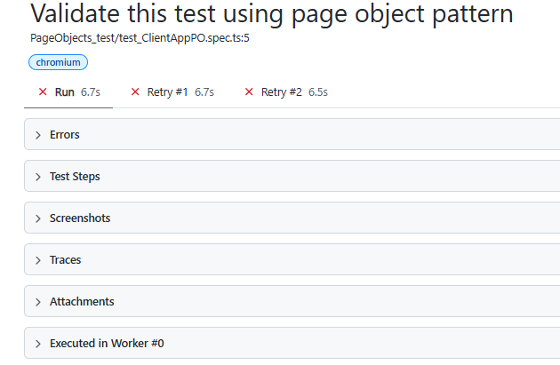

# Playwright Test Execution: Retry, Parallel, Serial & Tagging

This document explains how to configure and execute Playwright test cases using different execution strategies, including **Retry, Parallel Execution, Serial Execution, and Test Tagging**.

## 1. Retry Mechanism

### What is Retry?

Retry is used to automatically re-execute failed test cases.

For example, if a test case fails due to a temporary issue such as network latency or application loading, Playwright can retry the test automatically.

### Configuration

1. Open the `playwright.config.ts` file.
2. Add the `retries` property inside the configuration.

```typescript
import { defineConfig } from "@playwright/test";

export default defineConfig({
  retries: 2,
});
```

**Explanation:**

- `retries: 0` – No retry.
- `retries: 1` – Retry once if the test fails.
- `retries: 2` – Retry twice if the test fails.

**Example:** If a test case fails during its first execution and `retries: 2` is configured, Playwright will execute it up to 3 times (1 initial execution + 2 retries).

### Execute Test Using Terminal

```bash
npx playwright test "tests/PageObjects_test/test_ClientAppPO.spec.ts" --headed
```

### Retry Execution Flow

```text
Test Case Execution
        |
        v
   Test Passed?
     /     \
   Yes      No
   |         |
  End    Retry 1
             |
         Test Passed?
          /      \
        Yes       No
        |          |
       End      Retry 2
                    |
                Final Result
```

### Retry Report

The Playwright HTML report displays the retry attempts for failed test cases.



---

## 2. Parallel Execution

### What is Parallel Execution?

Parallel execution allows Playwright to execute multiple test files simultaneously using multiple workers.

- By default, Playwright runs test files in parallel.
- Playwright uses up to 50% of available CPU cores as workers by default.
- You can manually configure the number of workers in the configuration file.

### Configure Workers

Open `playwright.config.ts` and configure:

```typescript
import { defineConfig } from "@playwright/test";

export default defineConfig({
  workers: 5,
});
```

**Example:**

If you have 10 test files and configure 5 workers, Playwright can execute up to 5 test files simultaneously.

### Run Tests in Parallel (Default Behaviour)

```bash
npx playwright test
```

### Configure Single Worker

If you configure `workers: 1`, Playwright will execute test files one after another instead of running them in parallel.

```typescript
export default defineConfig({
  workers: 1,
});
```

**Important:**

- By default, different test files can run in parallel.
- Test cases within the same test file run sequentially by default.
- To execute test cases within the same file in parallel, use `mode: 'parallel'`.

---

## 3. Execute Test Cases Within a Single File in Parallel

By default, test cases inside a single test file execute sequentially.

If you want to execute test cases within the same file in parallel, use:

```typescript
import { test, expect } from "@playwright/test";

test.describe.configure({ mode: "parallel" });
test("Test Case 1 - Login", async ({ page }) => {
  // Test implementation
});

test("Test Case 2 - Dashboard", async ({ page }) => {
  // Test implementation
});

test("Test Case 3 - Logout", async ({ page }) => {
  // Test implementation
});
```

**Explanation:**

- `mode: 'parallel'` enables parallel execution within the test group.
- Each test runs independently.
- Tests should not depend on the execution order of other tests.

**Note:** Parallel tests should use independent test data and isolated resources to avoid conflicts.

---

## 4. Serial Execution

### What is Serial Execution?

Serial execution is useful when one test case depends on the successful execution of another test case.

For example:

- Test Case 1: Create a new user.
- Test Case 2: Update the user details.
- Test Case 3: Delete the user.

In this scenario, the test cases depend on each other.

### Configure Serial Execution

Use `test.describe.configure({ mode: 'serial' })`.

```typescript
import { test, expect } from "@playwright/test";

test.describe.configure({ mode: "serial" });
test("Test Case 1 - Create User", async ({ page }) => {
  // Create user
});

test("Test Case 2 - Update User", async ({ page }) => {
  // Update user
});

test("Test Case 3 - Delete User", async ({ page }) => {
  // Delete user
});
```

**Explanation:**

- Test cases execute one after another.
- If a test fails, subsequent tests in the serial group are skipped.
- Serial execution also affects retry behaviour: Playwright retries the serial group together.

**Important:** Serial execution should be used only when test cases genuinely depend on each other. Whenever possible, keep test cases independent.

---

## 5. Test Tagging

### What is Test Tagging?

Test tagging helps categorize test cases based on their purpose.

For example, in an automation framework, we may have:

| Tag           | Purpose                                     |
| ------------- | ------------------------------------------- |
| `@Smoke`      | Executes critical functionality tests       |
| `@Regression` | Executes the complete regression test suite |
| `@Sanity`     | Executes basic functionality checks         |
| `@Web`        | Identifies web application tests            |
| `@API`        | Identifies API tests                        |

### Define Tags at Test Level

You can define tags directly in the test case title.

**Example 1: Web Test**

```typescript
test("@Web Validate Client Application", async ({ page }) => {
  // Test implementation
});
```

**Example 2: Smoke Test**

```typescript
test("@Smoke Validate Login Functionality", async ({ page }) => {
  // Test implementation
});
```

**Example 3: Regression Test**

```typescript
test("@Regression Validate User Registration", async ({ page }) => {
  // Test implementation
});
```

## 6. Quick Reference – Playwright Commands

| Purpose                  | Command                                           |
| ------------------------ | ------------------------------------------------- |
| Run all tests            | `npx playwright test`                             |
| Run tests in headed mode | `npx playwright test --headed`                    |
| Run a specific test file | `npx playwright test tests/example.spec.ts`       |
| Run tests with 2 workers | `npx playwright test --workers=2`                 |
| Run tests with 1 worker  | `npx playwright test --workers=1`                 |
| Run Smoke tests          | `npx playwright test --grep "@Smoke"`             |
| Run Regression tests     | `npx playwright test --grep "@Regression"`        |
| Run Sanity tests         | `npx playwright test --grep "@Sanity"`            |
| Exclude Regression tests | `npx playwright test --grep-invert "@Regression"` |
| Open HTML report         | `npx playwright show-report`                      |

---

## 7. Summary

| Feature       | Configuration           | Purpose                                     |
| ------------- | ----------------------- | ------------------------------------------- |
| Retry         | `retries: 2`            | Re-executes failed tests up to 2 times      |
| Parallel      | `workers: 5`            | Executes multiple test files simultaneously |
| Single Worker | `workers: 1`            | Executes test files one after another       |
| Parallel Mode | `mode: 'parallel'`      | Executes tests within a file in parallel    |
| Serial Mode   | `mode: 'serial'`        | Executes dependent tests sequentially       |
| Tagging       | `@Smoke`, `@Regression` | Executes selected categories of tests       |

**Best Practices:**

1. Use Retry to handle temporary test failures.
2. Use Parallel Execution to reduce overall execution time.
3. Use Serial Execution only for dependent test scenarios.
4. Prefer independent test cases wherever possible.
5. Use Tags to organize and execute different testing suites.
6. Use HTML reports to analyze test execution results.

======================================================================

# Interview Question.

1. By default, do Playwright tests run in Serial or in Parallel?
   Answer: Parallel.

This answer leads to many follow-up questions.

2. What does "Parallel" mean?

- Take a test suite with 4 test files, containing 3 tests in each file (12 tests in total).

- What does "Parallel" mean for this test suite?
  Option What it claims-
  A All 12 tests run at the same time.
  B The 4 files run at the same time, and the 3 tests inside each file run one after another.

Answer B- But test Files will decided by workers

Q) What is a Worker?

## 2. How Playwright Workers Execute Tests in Parallel

### Understanding Workers and Parallel Execution

Playwright executes multiple "test files" in parallel using workers.

**Important concepts:**

1. Workers run in parallel with each other.
2. Tests inside one worker run "one after another" by default.
3. Each worker runs in a separate process.
4. Workers do not share "in-memory variables" with each other.
5. When a worker "finishes" its assigned test file, it can pick up another file from the "queue".

**Key Point:**

Parallel execution happens between workers, not between tests inside the same worker (by default).

### Example: 4 Test Files, 3 Test Cases Each File, 2 Workers

Consider the following test suite:

- Total test files: 4
- Test cases in each file: 3
- Total test cases: 12
- Number of workers: 2

**Execution Flow:**

Playwright maintains a queue of test files. Each available worker picks up a file, executes its test cases sequentially, and then picks up another file.

#### Test File Queue

```text
Queue:
File 1 | File 2 | File 3 | File 4

Each file contains 3 test cases.
```

#### Worker Execution

```text
Worker 0:
File 1 [T1 -> T2 -> T3]
              |
              v
File 3 [T1 -> T2 -> T3]

Total = 6 Test Cases


Worker 1:
File 2 [T1 -> T2 -> T3]
              |
              v
File 4 [T1 -> T2 -> T3]

Total = 6 Test Cases
```

#### Visual Execution Flow

```text
                 Playwright
                     |
               Test File Queue
                     |
          -------------------------
          |                       |
       Worker 0                Worker 1
          |                       |
       File 1                  File 2
          |                       |
       T1 -> T2                 T1 -> T2
          |                       |
          T3                     T3
          |                       |
       File 3                  File 4
          |                       |
       T1 -> T2                 T1 -> T2
          |                       |
          T3                     T3
```

**Note:** This is one possible execution outcome, not a fixed execution plan.

- Whichever worker becomes "free first can pick up" the next available "file".
- The execution order may change depending on how long each test file takes.
- Both workers can execute their assigned files simultaneously.

### What Happens When We Use `workers: 1`?

If you configure only one worker, all 4 test files will execute one after another.

```typescript
// playwright.config.ts

export default defineConfig({
  workers: 1,
});
```

**Execution Flow:**

```text
Worker 0
   |
   v
File 1 [T1 -> T2 -> T3]
   |
   v
File 2 [T1 -> T2 -> T3]
   |
   v
File 3 [T1 -> T2 -> T3]
   |
   v
File 4 [T1 -> T2 -> T3]
```

- "No parallel" execution between test files.
- All 12 test cases execute "sequentially".
- Only one worker process is used.

### Interview Questions

**Q1. Does Playwright execute all 12 test cases simultaneously when using 2 workers?**

Answer: No. By default, the 2 workers execute 2 test files simultaneously, and the test cases inside each file execute sequentially.

**Q2. What happens when we configure `workers: 1`?**

Answer: All test files execute sequentially using one worker.

**Q3. Can two workers share global variables or memory?**

Answer: No. Each worker runs in a separate process, so they do not share in-memory variables. However, they can access shared external resources such as databases and APIs.

**Q4. Does Playwright always assign 2 files to each worker?**

Answer: No. Playwright dynamically schedules available test files. The worker that finishes first can pick up the next available file.

**Q5. How can we execute test cases inside the same file in parallel?**

Answer: Use the following configuration:

```typescript
test.describe.configure({ mode: "parallel" });
```

This allows tests within the configured group to execute in parallel, subject to available workers.

### Follow-up Questions

#### Does every test get a fresh incognito-like context?

A worker "does not open" a new browser for every test. It launches one browser and reuses it. Only the "context" is created fresh "for each test".

**Execution Flow:**

```text
Worker 0 (Node process)
└── Browser (Chromium) → Launched ONCE per worker
    ├── Context for test 1 → closed
    ├── Context for test 2 → closed
    └── Context for test 3 → closed
```

"Launching a browser" takes around a second. "Creating a context" takes a few milliseconds. Playwright pays the expensive cost once per worker and the cheap cost once per test.

| Job     | Purpose                                                                                    | Cost                                  |
| ------- | ------------------------------------------------------------------------------------------ | ------------------------------------- |
| Context | Isolation: fresh cookies, localStorage and session, so test 2 cannot be affected by test 1 | Very cheap                            |
| Worker  | Parallelism: a separate process running its own tests at the same time as other workers    | Higher: a Node process plus a browser |

**In one line:**

Context answers "will my tests interfere?" and worker answers "how many run at the same time?"

Contexts keep tests independent, and that independence is what makes it safe to spread them across workers.

Next-

## Step 3: How Many Workers If You Set Nothing?

Playwright uses half of your machine's "logical CPU cores". The result is rounded down, with a minimum of 1.

### Default Worker Calculation

| Logical Cores | Default Workers |
| ------------: | --------------: |
|             4 |               2 |
|             8 |               4 |
|            16 |               8 |

### Check Worker Count During Execution

The test execution prints the number of workers at the top:

```text
Running 12 tests using 4 workers
```

### Check Logical CPU Cores on Your Machine

Run the following command in the terminal:

```bash
node -e "console.log(require('os').cpus().length)"
```

Halve the result to calculate the default number of workers.

### Two Things That Change the Number

**1. The Amount of Work**

Playwright never starts more workers than it has units of work.

With the default mode and "if only 2 test files, you get at most 2 workers", even on a 16-core machine.

**2. Your Config File**

The config from `npx playwright init` contains this line:

```javascript
workers: process.env.CI ? 1 : undefined,
```

`undefined` means "use the default", so "your laptop uses half the cores".
but if you are giving like this
workers: 2, then you are forcing to use only 2

On CI, where the CI variable is set, it forces 1 worker.

This is a classic interview scenario: tests take 2 minutes locally and 10 minutes on CI, and this line is the cause.

Try:
workers: 2
workers: '50%'
workers: '100%'

Disadvantage - if you give more load then RAM memory out then test flicky and fails

================================================================================

### Interview Question: Can We Run Tests Inside a Worker in Parallel?

Example Scenario:

- 4 test files
- 3 test cases in each file
- 2 workers
- Total: 12 test cases

Default Playwright Behaviour:

- Playwright assigns a "complete test file" to a worker.
- Multiple workers execute their assigned test files in parallel.
- Test cases inside the same file execute sequentially within the same worker.

Can We Execute Tests Inside the Same File in Parallel?

Yes. We can achieve this using `fullyParallel: true` in the Playwright configuration.

```
// playwright.config.ts

export default defineConfig({
    fullyParallel: true,
});
```

Important Consideration:

If test cases inside the same file are "dependent" on each other, enabling `fullyParallel: true` can cause test failures because tests may execute independently and in a different order.

Key Takeaway:

- Default: Parallel execution happens between test files.
- `fullyParallel: true`: Allows individual tests to run in parallel.
- Independent test cases are recommended for parallel execution.

| Comparison                                  | Default Playwright Execution                              | `fullyParallel: true`                                                   |
| ------------------------------------------- | --------------------------------------------------------- | ----------------------------------------------------------------------- |
| Unit assigned to a worker                   | A whole test file                                         | A single test case                                                      |
| Tests within one file                       | Execute sequentially in the same worker                   | Can execute across multiple workers                                     |
| Maximum workers that can run simultaneously | Limited by the number of test files                       | Limited by the number of test cases                                     |
| Hidden risk                                 | Tests may silently depend on each other's execution order | Such dependencies may cause failures immediately, helping identify them |
